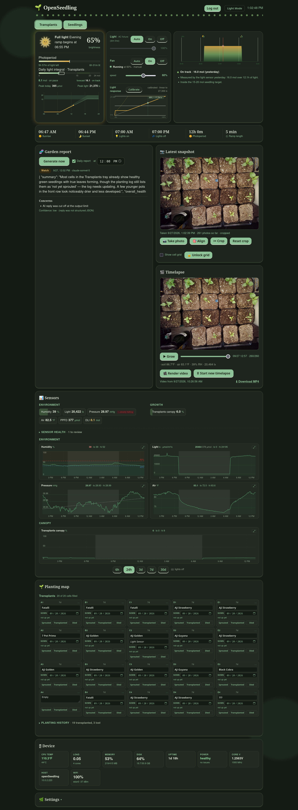

# openSeedling

A seedling station for the Raspberry Pi: a grow light that follows the sun, a
timelapse camera, soil and air sensors, optional automatic watering, a heat
mat thermostat, and a daily plant-health report, all run from one dashboard.

It runs on a Pi Zero 2 W. One Python process drives the hardware and serves
the dashboard; nothing depends on a cloud service except the optional AI
report and notifications.



## What it does

- **Light.** Follows local sunrise and sunset, a fixed clock schedule, or a
  day length, with ramps at both ends. Dims by hardware PWM, calibrates
  itself against a light sensor, and tracks the daily light integral against
  a target. A second fixture can run on its own schedule.
- **Watering.** Capacitive soil probes, a float switch per tray and level
  sensors on the reservoir. Auto-watering fills a dry tray to its float, with
  a time cap, a cooldown and a daily limit per tray.
- **Climate.** Air temperature, humidity and pressure, soil temperature, a
  fan, and a heat mat on a smart plug run as a thermostat.
- **Camera.** Timelapse photos at a set interval under a steady light, one or
  two USB cameras stitched into one frame, a flattened top-down view, a
  rendered video, and canopy coverage measured per tray.
- **Dashboard.** Live readings and charts, a planting map, grow setups that
  group lights, sensors and trays, and settings for all of it. Works on a
  phone; an optional touchscreen on the Pi shows a one-page summary.
- **Alerts.** Discord and ntfy notices when something is wrong: once when it
  starts, a reminder once a day, and once when it is fixed.
- **Daily report.** Sends the day's photo and readings to the Claude API and
  shows a per-setup health summary.

[docs/features.md](docs/features.md) describes each of these in detail.

## Hardware

A Raspberry Pi Zero 2 W (a Pi 3 or 4 should behave the same), a dimmable grow
light switched through a MOSFET or a 0-10 V dim line, and whichever of these
you want to use: a USB camera, an ADS1115 with capacitive soil probes, a
BME280, a BH1750 light sensor, a DS18B20 soil probe, 5 V pumps with float
switches, reservoir level sensors, a fan, and a TP-Link Kasa smart plug.
Anything not wired is simply left out of the dashboard.

Parts, wiring notes and the pinout are in [docs/hardware.md](docs/hardware.md).

## Install

Flash Raspberry Pi OS Lite (64-bit) with Raspberry Pi Imager, setting the
hostname, user, Wi-Fi, time zone and SSH there. Log in as that user and run:

```bash
curl -fsSL https://raw.githubusercontent.com/BenLeikin/openSeedling/main/scripts/setup.sh | bash
```

The script installs the packages, asks which GPIO each device is on, sets up
the service and offers to set a dashboard password. After the reboot, open
`http://<pi>:5000` and set your location in Settings.

The dashboard is open to anyone on your network until you set a password.
[docs/install.md](docs/install.md) covers the installer's options, updating,
and running behind a reverse proxy.

## Safety

This project switches mains-adjacent hardware (grow lights, pumps, heat mats)
and puts water near electronics. Build and run it at your own risk. Watch an
automatic waterer through several fills before you leave it alone, and put a
plug-in thermostat between a smart plug and a heat mat: a Pi that loses power
leaves the plug as it was.

## Documentation

| | |
| --- | --- |
| [Features](docs/features.md) | What each part does and how it decides |
| [Hardware](docs/hardware.md) | Parts, wiring and the pinout |
| [Install and update](docs/install.md) | The installer, deploying changes, a reverse proxy |
| [Configuration](docs/configuration.md) | Every setting, and where secrets live |
| [Touchscreen kiosk](docs/kiosk.md) | A summary page on the Pi's own display |
| [API](docs/api.md) | The HTTP endpoints the dashboard uses |
| [Heat mat tuning](docs/heat-tuning.md) | The thermostat's controller and how it was tuned |
| [Troubleshooting](docs/troubleshooting.md) | Sensors that do not read, cameras, memory |
| [Development](docs/development.md) | Tests, linting, and how the code is laid out |
| [Changelog](CHANGELOG.md) | What changed |

## Development

```bash
pip install -r requirements.txt -r requirements-dev.txt
python -m pytest        # the server tests; no hardware needed
ruff check . && ruff format --check . && mypy
```

The tests import the app from a temporary copy with GPIO, PWM and I2C
replaced by fakes, so they run on any machine. See
[docs/development.md](docs/development.md).

The service, its paths and its environment variables are named `growlight`,
the project's original name.

## License

MIT. See [LICENSE](LICENSE).
